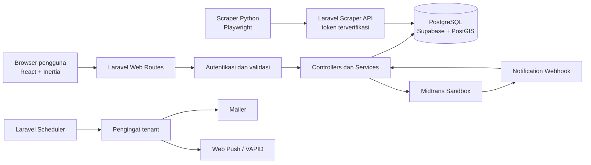
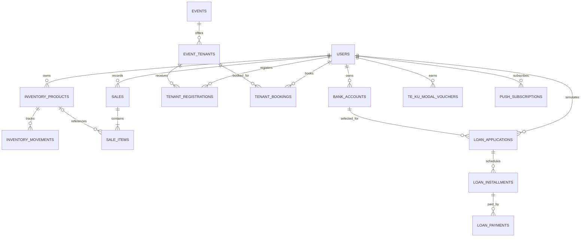

<div align="center">


# TeKu

### Ekosistem Digital untuk Operasional UMKM, Peluang Tenant, dan TeKuModal

[](.)
[](LICENSE)

**Submission for Garda Tech National Innovation Competition (GTNIC) 2026 — Web Development**

**By Tim Stmijktoke**

</div>

---

## Daftar Isi

- [Tim Developer](#tim-developer)
- [Tentang Proyek](#tentang-proyek)
- [Fitur Unggulan](#fitur-unggulan)
- [Demo dan Screenshot](#demo-dan-screenshot)
- [Teknologi](#teknologi)
- [Arsitektur Sistem](#arsitektur-sistem)
- [Instalasi dan Setup](#instalasi-dan-setup)
- [Penggunaan](#penggunaan)
- [Dokumentasi API](#dokumentasi-api)
- [Testing](#testing)
- [Lisensi](#lisensi)

---

## Tim Developer

| Nama                       | Peran                                 |
| -------------------------- | ------------------------------------- |
| **Muhana Fawwas Sausan**   | Project Lead & Full Stack Developer   |
| **Kevin Chandra Syahrial** | Full Stack Developer & UI/UX Designer |

---

## Tentang Proyek

### Latar Belakang

Dalam menjalankan usaha, pelaku UMKM perlu menjaga arus kas, mengelola persediaan dan transaksi, serta mencari peluang untuk menjangkau pelanggan baru. Dalam praktiknya, informasi event dan lokasi tenant tersebar di berbagai kanal, pencatatan stok dan penjualan dapat terpisah, sementara kebutuhan modal memerlukan perencanaan yang cermat.

Kondisi tersebut membuat pelaku usaha perlu berpindah-pindah alat untuk mengelola kegiatan sehari-hari dan menemukan peluang berjualan. TeKu dirancang untuk menyatukan beberapa kebutuhan tersebut dalam satu aplikasi web.

### Solusi yang Ditawarkan

**TeKu** adalah platform digital untuk membantu UMKM mengelola operasional usaha sekaligus menemukan peluang pasar. Aplikasi menyediakan manajemen inventaris, pencatatan transaksi melalui Point of Sale (POS), laporan penjualan, direktori event dan peluang tenant, serta simulasi pembiayaan melalui **TeKuModal**.

Untuk mendorong kebiasaan pembayaran yang teratur, TeKuModal dilengkapi gamifikasi berupa XP, konstelasi progres, TekuPoint, dan voucher reward. Pada prototipe ini, TeKuModal merupakan simulasi dan pembayaran menggunakan Midtrans Sandbox; tidak ada pencairan dana pinjaman sungguhan.

### Tujuan Proyek

- **Tujuan utama:** Membantu UMKM mengelola aktivitas operasional, menemukan peluang tenant, dan memahami simulasi kebutuhan modal dalam satu platform.
- **Target pengguna:** Pemilik dan pengelola UMKM, khususnya usaha kuliner, fesyen, kriya, dan produk rumahan.
- **Value proposition:** Operasional usaha, peluang event, pengingat jadwal tenant, dan gamifikasi pembayaran modal terintegrasi dalam satu aplikasi web.

---

## Fitur Unggulan

### Fitur Utama

| Fitur                              | Deskripsi                                                                                                                                  | Manfaat                                                                                            |
| ---------------------------------- | ------------------------------------------------------------------------------------------------------------------------------------------ | -------------------------------------------------------------------------------------------------- |
| **Dashboard usaha**                | Menampilkan ringkasan usaha, kalender, dan jadwal tenant terdaftar.                                                                        | Membantu pengguna melihat aktivitas usaha dan agenda mendatang.                                    |
| **Manajemen inventaris**           | Mencatat produk, kategori, harga, stok, batas minimum stok, dan tanggal produksi/kedaluwarsa.                                              | Memudahkan pemantauan persediaan dan perubahan stok.                                               |
| **POS dan penjualan**              | Mencatat transaksi, item penjualan, metode pembayaran, dan promosi.                                                                        | Menyatukan pencatatan transaksi dengan inventaris.                                                 |
| **Laporan penjualan**              | Menampilkan ringkasan penjualan, produk terlaris, dan laporan berdasarkan periode.                                                         | Membantu pengguna meninjau performa penjualan.                                                     |
| **Direktori event dan tenant**     | Menelusuri event berdasarkan pencarian dan kategori, melihat informasi jadwal, lokasi, biaya, serta tenggat jika tersedia.                 | Membantu pengguna menemukan peluang berjualan dan membuka informasi pendaftaran.                   |
| **Pendaftaran dan booking tenant** | Menandai pendaftaran tenant atau melanjutkan booking dan pembayaran sewa jika tersedia.                                                    | Membantu pengguna mengelola partisipasi event.                                                     |
| **Kalender dan pengingat**         | Menampilkan jadwal event dan mendukung pengingat email/browser sesuai konfigurasi.                                                         | Membantu pengguna mengingat jadwal tenant terdaftar.                                               |
| **Simulasi TeKuModal**             | Menghitung simulasi pinjaman dan jadwal angsuran.                                                                                          | Membantu pengguna memahami contoh rencana pembayaran; bukan persetujuan atau pencairan dana nyata. |
| **Gamifikasi konstelasi**          | Pembayaran cicilan tepat waktu memberi XP. Setiap 100 XP memberikan 120 TekuPoint yang dapat digunakan untuk menukar reward sesuai syarat. | Memberi apresiasi dan mendorong kebiasaan pembayaran tepat waktu.                                  |
| **Event Radar**                    | Menampilkan peluang event yang dihimpun scraper dari akun Instagram yang dikonfigurasi.                                                    | Menyajikan informasi peluang dalam direktori yang dapat ditelusuri.                                |

### Keunikan dan Nilai Inovasi

TeKu menggabungkan kebutuhan yang biasanya dikelola terpisah: operasional toko, pencarian peluang berjualan offline, dan simulasi modal. Pengguna dapat memantau persediaan dan penjualan sambil menjelajahi event yang relevan.

Gamifikasi TeKuModal menggunakan visualisasi konstelasi untuk menunjukkan progres XP, bukan hanya menampilkan angka poin. Reward ditujukan untuk mendorong keteraturan pembayaran dan tidak digunakan sebagai skor kredit atau penentu kelayakan pinjaman.

---

## Demo

### Live Demo

https://gtnic.onrender.com/dashboard

## Teknologi

### Stack Utama

| Bagian                | Teknologi                                                 |
| --------------------- | --------------------------------------------------------- |
| Backend               | PHP 8.3, Laravel 12                                       |
| Frontend              | React 19, TypeScript, Inertia.js                          |
| Styling & asset build | Tailwind CSS 4, Vite 6                                    |
| Database              | PostgreSQL di Supabase, dengan PostGIS untuk lokasi event |
| Container             | Docker multi-stage, Node.js 22 dan PHP 8.3 Apache         |
| Scraper               | Python, Playwright, Requests, Pillow                      |
| Pembayaran            | Midtrans Sandbox untuk alur demonstrasi                   |
| Push notification     | Web Push dengan kunci VAPID                               |
| Pengujian             | Pest melalui Laravel Test Runner                          |

### Dependencies Utama

Backend menggunakan Laravel, Inertia Laravel, Laravel Sanctum, Midtrans PHP SDK, dan Minishlink Web Push. Frontend menggunakan React, Inertia React, TypeScript, Tailwind CSS, dan Vite. Rincian versi dependency tersedia di `composer.json` dan `package.json`.

---

## Arsitektur Sistem

### System Architecture



### Alur Utama

1. Pengguna mengakses aplikasi melalui browser dan masuk ke akun.
2. Antarmuka React berkomunikasi dengan Laravel menggunakan Inertia.
3. Laravel memvalidasi permintaan, menjalankan aturan bisnis, dan membaca/menyimpan data di PostgreSQL Supabase.
4. Scraper terpisah mengirim data event ke endpoint yang dilindungi token.
5. Pembayaran demonstrasi menggunakan Midtrans Sandbox; status diperbarui melalui alur return dan notifikasi provider.
6. Laravel Scheduler memproses pengingat tenant sesuai jadwal dan konfigurasi layanan.

### Database Schema



Tabel inti mencakup pengguna, inventaris dan pergerakan stok, penjualan dan item transaksi, event dan peluang tenant, pendaftaran dan booking tenant, rekening bank, simulasi pinjaman dan cicilan, pembayaran, voucher, serta langganan push notification.

### Folder Structure

```text
app/
├── Console/Commands/    # Perintah dan tugas terjadwal
├── Http/Controllers/    # Controller web dan API
├── Jobs/                # Pemrosesan data event
├── Mail/                # Email pengingat
├── Models/              # Model Eloquent
├── Services/            # Layanan pembayaran dan reward
└── Support/             # Helper domain
database/
└── migrations/          # Perubahan skema basis data
resources/
├── js/                  # React, TypeScript, halaman, dan komponen
└── views/               # Blade shell dan template email
routes/
├── api.php              # Endpoint API
└── web.php              # Route aplikasi web
scraper/                 # Scraper Instagram Python
tests/
├── Feature/             # Pengujian alur aplikasi
└── Unit/                # Pengujian unit
Dockerfile               # Image aplikasi multi-stage
```

---

## Instalasi dan Setup

### Prerequisites

- Docker Desktop atau Docker Engine
- Akses ke proyek Supabase PostgreSQL yang sudah menyiapkan ekstensi PostGIS
- Kredensial layanan yang diperlukan, disimpan sebagai environment variables/secrets

Untuk pengembangan tanpa Docker, siapkan PHP 8.3+, Composer, Node.js 22+, npm, dan Python jika scraper akan dijalankan.

### Menjalankan dengan Docker

1. Clone repository:

    ```bash
    git clone <URL_REPOSITORY>
    cd TeKu
    ```

    Ganti `<URL_REPOSITORY>` dengan URL repository proyek.

2. Siapkan file `.env` lokal. Jangan commit file tersebut:

    ```bash
    cp .env.example .env
    ```

    Windows Command Prompt:

    ```bat
    copy .env.example .env
    ```

3. Buat `APP_KEY` dengan perintah `php artisan key:generate --show` dari instalasi Laravel lokal, atau sediakan key acak yang aman melalui secret manager platform. Jangan gunakan key yang sama untuk beberapa aplikasi atau environment.

4. Isi konfigurasi minimum aplikasi dan koneksi Supabase:

    ```env
    APP_NAME=TeKu
    APP_ENV=production
    APP_DEBUG=false
    APP_KEY=base64:GENERATE_A_SECURE_KEY
    APP_URL=https://your-domain.example

    DB_CONNECTION=pgsql
    DB_HOST=YOUR_SUPABASE_DATABASE_HOST
    DB_PORT=5432
    DB_DATABASE=postgres
    DB_USERNAME=YOUR_SUPABASE_DATABASE_USER
    DB_PASSWORD=YOUR_SUPABASE_DATABASE_PASSWORD
    DB_SSLMODE=require
    ```

    Ambil host, port, dan username persis dari **Supabase Dashboard → Project Settings → Database → Connect**. Transaction pooler sering menggunakan port `6543`; ikuti nilai yang diberikan Supabase. Jangan menaruh kredensial produksi dalam README, Dockerfile, atau Git.

5. Build image dan jalankan container:

    ```bash
    docker build -t teku .
    docker run --name teku -p 10000:10000 --env-file .env teku
    ```

    Aplikasi tersedia di `http://localhost:10000`. Container menggunakan `PORT=10000` secara default.

> **Penting:** Dockerfile menjalankan `php artisan migrate --force` saat container mulai. Perintah ini menerapkan migration yang belum berjalan pada database di `.env`. Pastikan target Supabase benar dan backup tersedia sebelum menjalankan pada data produksi.

File yang diunggah disimpan melalui Laravel Filesystem. Untuk deployment Docker yang persisten, atur disk/storage eksternal atau volume persisten pada platform hosting; filesystem container dapat hilang saat container diganti.

### Menjalankan Lokal Tanpa Docker

1. Pasang dependency:

    ```bash
    composer install
    npm install
    ```

2. Salin `.env.example` ke `.env`, isi `APP_KEY` dan kredensial Supabase seperti contoh di atas.
3. Jalankan migration dan buat link storage:

    ```bash
    php artisan migrate
    php artisan storage:link
    ```

4. Jalankan aplikasi dan Vite:

    ```bash
    composer run dev
    ```

    Secara default aplikasi tersedia di `http://localhost:8000` dan `/` mengarah ke halaman login.

### Konfigurasi Layanan Opsional

| Layanan      | Environment variables                                                                                            |
| ------------ | ---------------------------------------------------------------------------------------------------------------- |
| Midtrans     | `MIDTRANS_SERVER_KEY`, `MIDTRANS_CLIENT_KEY`                                                                     |
| Email        | `MAIL_MAILER`, `MAIL_HOST`, `MAIL_PORT`, `MAIL_USERNAME`, `MAIL_PASSWORD`, `MAIL_FROM_ADDRESS`, `MAIL_FROM_NAME` |
| Browser push | `VAPID_SUBJECT`, `VAPID_PUBLIC_KEY`, `VAPID_PRIVATE_KEY`                                                         |
| Scraper API  | `SCRAPER_API_TOKEN`                                                                                              |

Buat kunci VAPID dengan `php artisan webpush:keys`. Atur scheduler untuk menjalankan `php artisan schedule:run` setiap menit di server. Pengiriman email, push notification, dan pembayaran produksi memerlukan konfigurasi layanan terkait.

---

## Penggunaan

### Pengguna UMKM

1. Daftar atau masuk ke TeKu.
2. Tambahkan produk dan atur jumlah stok di menu inventaris.
3. Catat transaksi melalui POS, lalu tinjau riwayat dan laporan penjualan.
4. Cari event berdasarkan kategori; periksa jadwal, lokasi, biaya, dan tenggat yang tersedia.
5. Buka detail peluang tenant untuk melihat jalur pendaftaran atau booking.
6. Gunakan kalender untuk memantau agenda dan pengingat tenant.
7. Buka TeKuModal untuk melihat simulasi pinjaman, jadwal angsuran, progres XP, TekuPoint, dan voucher.

### Event Radar dan Scraper

Scraper mengirim data ke API dengan token rahasia `SCRAPER_API_TOKEN`. Data kategori dapat dikirim oleh scraper; jika tidak disediakan, aplikasi mencoba mengenali kategori dari judul dan deskripsi. Data event hasil ekstraksi sebaiknya dikonfirmasi ke penyelenggara karena dapat berubah atau tidak lengkap.

---

## Dokumentasi API

Endpoint scraper dan webhook pembayaran tersedia di Laravel API. Route aplikasi web lainnya memerlukan autentikasi sesi pengguna.

### Scraper Event

```http
POST /api/scraped-events
GET  /api/scraped-events/known-posts?account={account}
POST /api/scraped-events/seen-posts
```

Semua endpoint scraper membutuhkan bearer token yang cocok dengan `SCRAPER_API_TOKEN`. `POST /api/scraped-events` menerima informasi event yang divalidasi, termasuk judul, deskripsi, koordinat, URL posting Instagram, akun sumber, dan kategori opsional.

### Midtrans Notification

```http
POST /api/midtrans/notifications
```

Endpoint ini menerima notifikasi status transaksi Midtrans dan memvalidasi data transaksi sebelum memperbarui status pembayaran. Gunakan URL HTTPS publik yang dikonfigurasi pada dashboard Midtrans untuk lingkungan terkait.

### Route Web Utama

```text
GET  /                  Redirect ke /login
GET  /dashboard         Dashboard usaha (login diperlukan)
GET  /inventory         Daftar inventaris (login diperlukan)
GET  /sales/pos         POS (login diperlukan)
GET  /sales/report      Laporan penjualan (login diperlukan)
GET  /events            Direktori event (login diperlukan)
GET  /event-dashboard   Dashboard event dan tenant (login diperlukan)
GET  /calendar           Kalender event (login diperlukan)
GET  /tekumodal          Simulasi TeKuModal (login diperlukan)
GET  /radar              Event Radar
```

Route lengkap dapat dilihat dengan `php artisan route:list`.

---

## Testing

Jalankan pengujian backend:

```bash
php artisan test
```

Build frontend untuk memverifikasi TypeScript dan bundling:

```bash
npm run build
```

Periksa format kode:

```bash
vendor/bin/pint --test
npm run format:check
```

---

## Lisensi

TeKu dilisensikan di bawah **MIT License**. Lihat file [LICENSE](LICENSE).

---

<div align="center">

**Dikembangkan oleh Tim Stmijktoke untuk GTNIC 2026**

</div>
